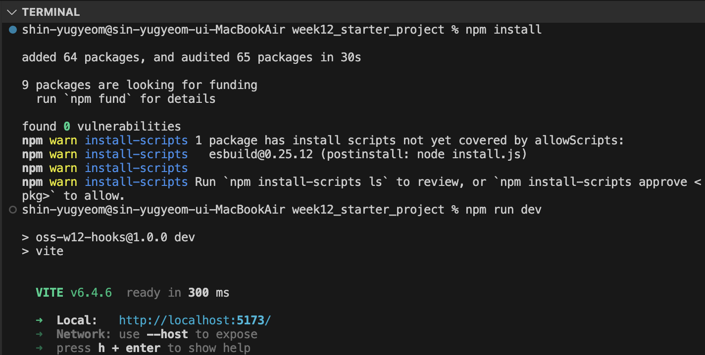

## 1 Project Information: 프로젝트 소개 및 Starter Project 정보
- 프로젝트 소개 : useEffect와 useRef의 동작 원리를 이해하여 타이머 관리와 입력창 Focus 기능을 구현한다.
- Starter Project 정보 : https://github.com/2026-2-OSS/week12_starter_project.git

## 2 Installation: 설치·실행 방법 및 실행 화면
fork >
clone git repository >
reponpm install >
npm run dev



## 3 Source Code Exploration: 주요 파일 구조, useEffect 및 useRef 분석, 주요 코드 2개 설명
### Project Structure: App.jsx와 주요 Lab 컴포넌트의 역할
- App.jsx : 메인 컴포넌트, 4개의 Lab 컴포넌트를 화면에 표시한다. labs 배열에 각 Lab의 이름과 컴포넌트 정보를 저장
- lab1 : 1초마다 증가하는 타이머
- lab2 : 타이머의 Start, Stop, Reset 기능
- lab3 : Focus 버튼으로 입력창에 포커스를 호출하고, Clear 버튼으로 입력 내용을 지우는 기능
- lab4 : 타이머 ID를 저장하여 타이머를 관리하는 기능, Start, Stop, Reset 버튼

### useEffect: Effect, Dependency Array 및 Cleanup의 동작 원리
- Effect : 부 시스템과 컴포넌트를 동기화하기 위해 사용하는 Hook
- Dependency Array : 실행 시점 지정. [] - 최초 마운트 시 실행 / [running]: 최초 마운트 및 running 값이 변경되었을 때 실행
- Cleanup : 이전 Effect가 수행한 작업을 정

### useRef: .current 속성과 useState의 차이
- useRdf : 렌더링 간에 유지되는 값을 저장하거나 DOM 요소를 참조하는 Hook
- .current : useRef가 보관하는 현재 값에 접근하는 속성
- useState의 차이 : useState의 값을 변경하면 컴포넌트가 다시 렌더링되지만, useRef의 .current 값을 변경해도 리렌더링이 발생하지 않는다.

### Code Analysis: useEffect와 useRef 관련 주요 코드 각 1개(5~15줄)를 선택하여 동작 원리 설명
    useEffect(() => {
        // TODO 1: 1초마다 setCount(prev => prev + 1)을 실행할 setInterval 작성
        // TODO 2: 만든 타이머 ID를 보관
        // TODO 3: return Cleanup 함수에서 clearInterval 호출
        // TODO 4: Dependency Array가 []일 때와 생략했을 때의 차이 관찰
    }, []);
Dependency Array가 []이므로 최초 마운트 시 Effect가 실행된다. setInterval로 1초마다 Count를 증가시키고, Cleanup에서 clearInterval을 호출하여 컴포넌트가 사라질 때 타이머를 정리하게 된다.
    import { useRef } from 'react';

    // LAB 3 (Slide 15): Input Focus with useRef
    export default function Lab3InputFocus() {
    // TODO 1: input DOM을 참조할 inputRef 생성 (초기값 null)

    const focusInput = () => {
        // TODO 2: ref.current를 이용해 input에 focus() 호출
    };

    const clearInput = () => {
        // TODO 3: input의 값을 지우고 다시 Focus
    };
useRef가 import되어 있다. useRef(null)로 Input 요소를 참조하고, .current.focus()를 통해 입력창으로 포커스를 이동시킬 수 있다.

## 4 Lab Implementation: 4개 Lab 구현 내용 및 실행 결과
### lab1
- 구현 내용 : setInterval을 통해 1초마다 count가 1 증가, clearInterval 호출하여 정리
- 실행 결과 : 1초마다 1 증가
### lab2
- 구현 내용 : running State와 useEffect를 이용하여 Start, Stop, Reset 기능 구현.
- 실행 결과 : start 버튼을 누르면 1 증가, stop을 누르면 멈춤, reset을 누르면 초기화
### lab3
- 구현 내용 : input DOM을 참조할 inputRef 생성하고, .current를 이용하여 input에 focus() 호출
- 실행 결과 : Focus 버튼을 누르면 입력창으로 커서가 이동하고, Clear 버튼을 누르면 입력값을 초기화
### lab4
- 구현 내용 : useRef에 타이머 ID를 저장하여 Start, Stop, Reset 기능 구현.
- 실행 결과 : start 버튼을 누르면 1 증가, stop을 누르면 멈춤, reset을 누르면 초기화

## 5 Lab Comparison: STEP 3의 비교 분석 질문 4개에 대한 답변
- useEffect의 Dependency Array가 필요한 이유는? : Dependency Array는 실행 시점 지정한다. 지정하지 않으면 렌더링될 때마다 Effect가 다시 실행된다.
- Cleanup을 사용하지 않으면 어떤 문제가 발생할 수 있는가? : Cleanup을 사용하지 않으면 setInterval로 생성한 타이머가 정리되지 않아 컴포넌트가 사라진 후에도 계속 실행되거나, 타이머가 중복 생성될 수 있다.
- useState와 useRef의 가장 중요한 차이는? : 값 변경 시 렌더링 차이. useState는 값 변경시 리렌더링 하며, useRef는 .current 값을 변경해서 리렌더링 하지 않는다.
- LAB 2와 LAB 4의 Timer 관리 방식은 어떻게 다른가? : LAB2는 State와 useEffect를 사용하여 타이머를 관리하고, LAB4는 useRef에 ID를 저장하여 타이머를 관리한다.

## 6 Customizing: 수정 내용 및 파일명
### 프로젝트 제목 또는 설명 변경
- 파일명 : App.jsx
- 수정 내용 : <h1>React Hooks Playground</h1> >> <h1>useEffect, useRef를 활용하여 타이머와 focuse 기능 구현</h1>
### CSS 스타일 2곳 이상 변경
- 파일명 : App.css
- 수정 내용 : .tab.active의 color: #214bb1; >> color: orange;
- 수정 내용 : .lab-panel의 border-radius: 16px; >> border-radius: 0px;

## 7 Deployment: 실제 접근 가능한 Vercel URL
https://week12-starter-project-rocu.vercel.app/

## 8 Weekly Review:
### 새롭게 배운 내용 3가지
- useRdf와 useState의 차이 : useState의 값을 변경하면 컴포넌트가 다시 렌더링되지만, useRef의 .current 값을 변경해도 리렌더링이 발생하지 않는다.
- Cleanup의 역할 : Cleanup을 사용하지 않으면 setInterval로 생성한 타이머가 정리되지 않는다. clearInterval()을 통해 기존 타이머를 정리하여 컴포넌트가 사라진 후에도 타이머가 실행되거나 중복 생성되는 문제를 방지한다.
- useEffect의 Dependency Array : Dependency Array는 실행 시점 지정한다. 지정하지 않으면 렌더링될 때마다 Effect가 다시 실행된다. 
### 어려웠던 점과 해결 방법
코드에 todo가 나와있고 수업자료에 코드가 나와있어 코드 작성 자체는 크게 어려웠던 점은 없었다. 이해가 안되거나 부족한 개념은 ai를 사용하여 공부했다.
### AI 활용 내용 및 느낀 점
useRef의 .current 기능 / cleanup 역할


# OSS Week 12 — React Hooks Playground (Student Starter)

## 실행 방법
Node.js 20.19+ 또는 22.12+ 권장. 프로젝트 폴더에서 실행:

```bash
npm install
npm run dev
```

브라우저에 터미널의 Local URL을 열고 LAB 탭을 이동하세요. 제출 전 `npm run build`도 실행하세요.

## 수행 방법
1. `src/components/` 아래의 LAB 1~4 파일에 있는 `TODO`를 직접 완성합니다.
2. `src/App.jsx`, `src/App.css`는 공통 화면이므로 가급적 수정하지 않습니다.
3. 각 LAB의 동작 화면과 콘솔 결과를 기록합니다.
4. 한 LAB에서 다른 LAB으로 탭을 전환하면 기존 컴포넌트가 언마운트됩니다. Cleanup 결과를 관찰합니다.


## 이해도 확인 질문
1. `setCount(prev => prev + 1)`은 왜 유용한가?
2. `useEffect(fn, [])`과 `useEffect(fn)`은 어떻게 다른가?
3. Cleanup은 언제 실행되는가? 개발 환경 StrictMode 영향은?
4. `useState`와 `useRef`의 값 변경 시 렌더링 차이는?
5. LAB 2와 LAB 4에서 Timer를 관리하는 방식의 차이는?
